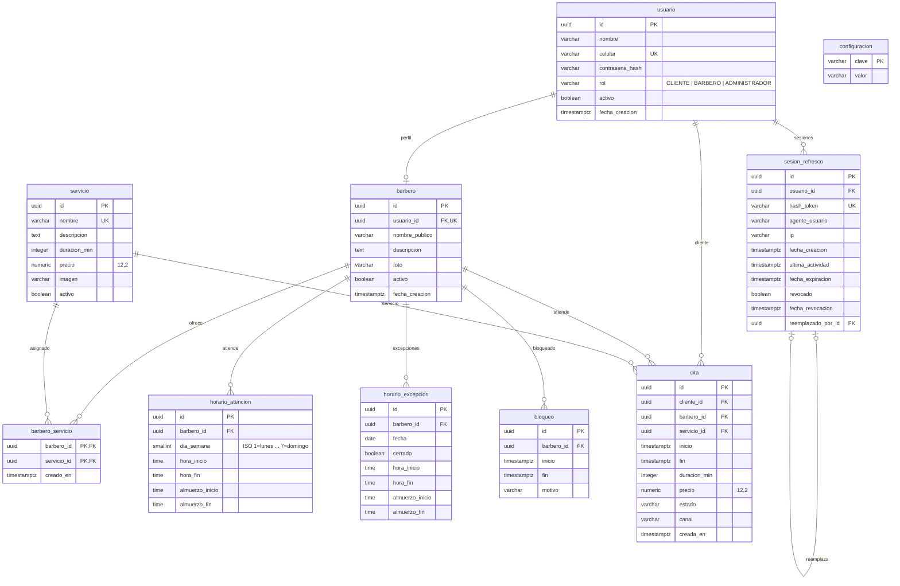

# Modelo de datos OalBarber

**Estado:** esquema implementado por Flyway en V1–V11. Incluye cuentas, catálogo, perfiles,
asignaciones, horarios semanales, excepciones, bloqueos, configuración y citas. El SRS se conserva
sin cambios. **Última revisión:** 2026-11-26.

## Tablas implementadas

Las migraciones V1–V8 de `develop` se conservan: `usuario` (V1), `sesion_refresco` (V2), `servicio`
(V3), `barbero` (V4), `barbero_servicio` (V5), `barbero.fecha_creacion` (V6), `horario_atencion`
(V7) y `horario_excepcion` (V8). PB-22 añade `bloqueo` y `configuracion` (V9), `cita` (V10) y el
catálogo provisional (V11). Todos los identificadores de las entidades son UUID.

## Integridad y disponibilidad

- `barbero_servicio` es la asignación entre perfiles y catálogo; tiene clave primaria compuesta,
  FKs con `ON DELETE RESTRICT` e índice por `servicio_id`.
- `horario_atencion` guarda una jornada por barbero y día ISO: 1=lunes y 7=domingo. La semana
  ordinaria no permite configurar domingo por RN-01. Los días sin fila están cerrados.
- `horario_excepcion` prevalece sobre el horario semanal de esa fecha: puede abrir un domingo,
  cerrar un festivo o reemplazar jornada y almuerzo. Una excepción cerrada no contiene horas; una
  abierta contiene una jornada válida y almuerzo opcional.
- El esquema de horario usa `almuerzo_inicio` y `almuerzo_fin`, según V7 de `develop`.
- `bloqueo` y `cita` representan intervalos semiabiertos `[inicio, fin)`.
- V10 habilita `btree_gist` y excluye solapamientos por barbero mediante
  `tstzrange(inicio, fin, '[)')`, solo donde `estado <> 'CANCELADA'`. Un índice parcial cubre
  citas vigentes por barbero e inicio.
- V9 inicializa parámetros RN-18: anticipación mínima de 24 horas, límite de cancelación de 2
  horas, máximo de 7 días, intervalo de turnos de 40 minutos y margen entre citas de 0 minutos.
- V11 carga corte normal (40 min), corte premium (90 min), mechas (180 min) y ondulación (180 min).
  Los precios COP 1.00 están marcados como provisionales por P-05 y deben reemplazarse antes de
  publicar el catálogo real.
- La disponibilidad se calcula al consultar y no modifica ni reubica citas existentes.

## Perfiles e identidades

`barbero` es un perfil separado de la identidad. El nombre, celular y credenciales permanecen en
`usuario`; el perfil guarda presentación pública, estado profesional y fecha de creación. La cuenta
del administrador puede agregarse explícitamente como perfil sin cambiar su identidad. Cambiar
`barbero.activo` no modifica `usuario.activo` ni revoca sus sesiones.

Las cuentas y perfiles se crean desde el flujo administrativo. El DTO público de barberos no expone
el nombre ni el celular de la cuenta. El rol real es `ADMINISTRADOR`; la diferencia con `ADMIN` del
SRS y el frontend se registra en el [ADR-0004](../decisiones/ADR-0004-calculo-de-disponibilidad.md).

## Referencias

- [SRS](../srs/SRS-OalBarber.md)
- [ADR-0001: UUID en identidades y perfiles](../decisiones/ADR-0001-uuid-en-identidades.md)
- [ADR-0002: asignación barbero-servicio y consulta de citas](../decisiones/ADR-0002-asignacion-barbero-servicio-y-consulta-citas.md)
- [ADR-0004: cálculo de disponibilidad](../decisiones/ADR-0004-calculo-de-disponibilidad.md)
