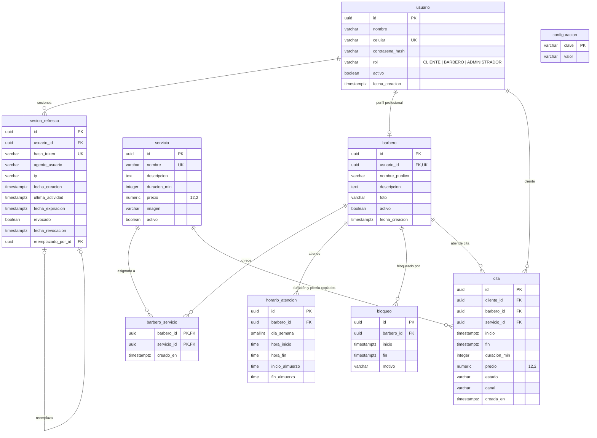

# Modelo de datos OalBarber

**Estado:** esquema implementado por Flyway en V1–V9. Incluye usuarios, sesiones, servicios,
perfiles, asignaciones, horarios, bloqueos, configuración y citas. **Última revisión:** 2026-11-25.
El SRS se conserva sin cambios.

## Tablas implementadas

Las migraciones crean `usuario` (V1), `sesion_refresco` (V2), `servicio` (V3), `barbero` (V4),
`barbero_servicio` (V5), agregan `barbero.fecha_creacion` (V6), crean horarios, bloqueos y
parámetros (V7), crean citas junto con la restricción de exclusión (V8) y cargan el catálogo inicial
(V9). Las entidades nuevas usan UUID como el resto de identidades del backend.

## Integridad de agenda

- `barbero_servicio` pertenece a `barbero`, usa clave primaria compuesta y restringe el borrado de
  perfiles o servicios relacionados. El service consulta el catálogo a través de `ServicioService`.
- `horario_atencion` guarda un registro por barbero y día ISO (1=lunes…6=sábado). Domingo se
  representa sin fila. Las columnas del almuerzo son nulas cuando no se ha definido una franja.
- `bloqueo` y `cita` usan intervalos semiabiertos `[inicio, fin)`, con inicio anterior al fin.
- `cita` copia duración y precio vigentes del servicio. La disponibilidad se calcula al consultar;
  no se almacena ni reubica citas existentes.
- V8 habilita `btree_gist` y crea una restricción `EXCLUDE USING gist` sobre el barbero y
  `tstzrange(inicio, fin, '[)')`, solo cuando `estado <> 'CANCELADA'`. Un índice parcial adicional
  soporta la consulta de citas vigentes por barbero e inicio.
- V7 inicializa `anticipacion_minima_horas=24`, `maximo_dias_adelante=7`,
  `intervalo_turnos_minutos=40` y `margen_entre_citas_minutos=0` en `configuracion`.
- V9 inserta corte normal (40 min), corte premium (90 min), mechas (180 min) y ondulación (180 min).
  Cada precio está temporalmente en COP 1.00 como marcador técnico, explícitamente provisional
  hasta cerrar P-05; debe sustituirse antes de publicar el catálogo real.
- El horario de atención y el almuerzo se leen de `horario_atencion`; esta HU no inventa ni carga
  horas de almuerzo.

## Perfiles e identidades

`barbero` es un perfil separado de la identidad. El nombre, celular y credenciales permanecen en
`usuario`; el perfil guarda presentación pública, estado profesional y fecha de creación. El
inicializador no crea perfil para el administrador: este se agrega explícitamente mediante
`POST /api/barberos/admin`, que reutiliza su cuenta e inserta solo una fila en `barbero`. Cambiar
`barbero.activo` no cambia `usuario.activo` ni revoca sus sesiones.

Las cuentas y perfiles de barberos se crean desde el flujo administrativo. El DTO público omite el
nombre y celular de la cuenta. El enum real es `RolUsuario.ADMINISTRADOR`; la diferencia con
`ADMIN` del SRS y el frontend se registra en el
[ADR-0004](../decisiones/ADR-0004-calculo-de-disponibilidad.md) y no se modifica en PB-22.

## Referencias

- [SRS](../srs/SRS-OalBarber.md)
- [ADR-0001: UUID en identidades y perfiles](../decisiones/ADR-0001-uuid-en-identidades.md)
- [ADR-0002: asignación barbero-servicio y consulta de citas futuras](../decisiones/ADR-0002-asignacion-barbero-servicio-y-consulta-citas.md)
- [ADR-0004: cálculo de disponibilidad](../decisiones/ADR-0004-calculo-de-disponibilidad.md)
