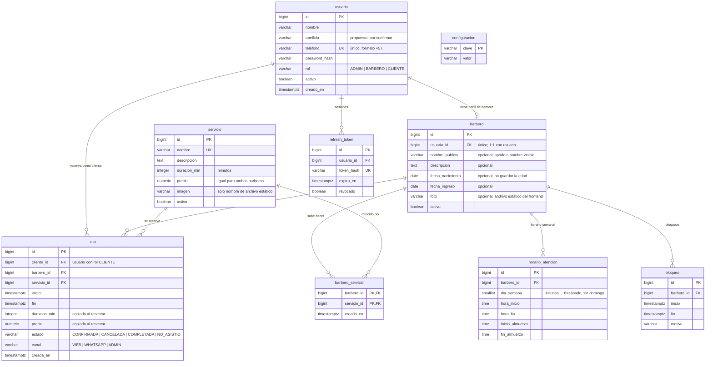
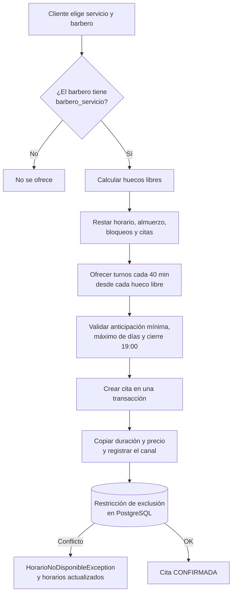

# Modelo de datos propuesto

**Estado:** borrador para revisión. Extiende el modelo preliminar del
[SRS](../srs/SRS-OalBarber.md) con las decisiones tomadas al revisar los módulos
(`usuario` como identidad única, `barbero` como perfil profesional y `barbero_servicio` como
relación muchos a muchos).

> El SRS todavía describe ocho tablas. Este documento propone nueve y agrega campos opcionales
> al perfil del barbero. Cuando el cliente y el equipo aprueben el modelo, se actualiza el SRS y
> se crea la migración `V1` con este esquema.

## Diagrama entidad-relación



## Cómo leer el modelo

- **`usuario` es la identidad de todos.** Clientes, barberos y administradores se autentican con
  celular y contraseña; el rol decide qué pueden hacer. No existe una tabla `cliente` separada:
  un cliente es un `usuario` con rol `CLIENTE`.
- **`barbero` es un perfil profesional, no un segundo usuario.** Tiene una relación 1:1 con
  `usuario` (`usuario_id` único). El administrador también tiene su fila en `barbero` porque
  también atiende. El perfil guarda datos que solo aplican a quien corta; el nombre y el celular
  siguen en `usuario` para no duplicarlos.
- **`barbero_servicio` resuelve el muchos a muchos.** Un barbero sabe hacer varios servicios y un
  servicio lo pueden hacer varios barberos. Si no existe la fila, ese barbero no se ofrece para
  ese servicio.
- **`servicio` es un catálogo único.** El precio y la duración son iguales para ambos barberos.
  `imagen` guarda solo el nombre de un archivo de `frontend/public/servicios/`; no hay subida de
  imágenes.
- **`horario_atencion`** define la semana de cada barbero. No hay fila para el domingo. El almuerzo
  es el único descanso y se guarda en la misma fila del día.
- **`bloqueo`** cubre una franja o una fecha completa. No cancela citas: el sistema avisa si hay
  citas dentro del rango y pide confirmación.
- **`cita`** guarda el inicio y el fin exactos, y copia `duracion_min` y `precio` del servicio al
  momento de reservar. Cambiar el catálogo después no modifica citas existentes.
- **`configuracion`** guarda los parámetros de la RN-18: anticipación mínima, límite de
  cancelación, máximo de días, intervalo entre turnos y margen entre citas.
- **`refresh_token`** permite renovar la sesión y revocar el token al cerrar sesión.

## Reglas de integridad

- `usuario.telefono` es único y se guarda en formato internacional (`+57...`).
- `usuario.password_hash` guarda BCrypt; nunca la contraseña en claro.
- `barbero.usuario_id` es único y referencia a un `usuario` con rol `BARBERO` o `ADMIN`.
- `barbero_servicio` tiene clave primaria compuesta `(barbero_id, servicio_id)` y claves foráneas
  a `barbero` y `servicio`.
- `horario_atencion` tiene una fila por barbero y día: único `(barbero_id, dia_semana)`.
- `bloqueo` y `cita` validan `fin > inicio`.
- `cita.duracion_min > 0` y `cita.precio >= 0`.
- Las citas del mismo barbero no pueden solaparse. La garantía final es una restricción de
  exclusión de PostgreSQL:

```sql
-- Requiere: CREATE EXTENSION IF NOT EXISTS btree_gist;
ALTER TABLE cita
  ADD CONSTRAINT cita_sin_solapamiento
  EXCLUDE USING gist (
    barbero_id WITH =,
    tstzrange(inicio, fin, '[)') WITH &&
  )
  WHERE (estado <> 'CANCELADA');
```

- Todas las fechas usan `timestamptz` y la zona horaria `America/Bogota`.
- La disponibilidad **no se almacena**: se calcula al consultar a partir de horarios, almuerzo,
  bloqueos, citas y servicios habilitados del barbero.

## Cómo se comporta una reserva



## Pendientes de confirmar con el cliente

- Si se separa `nombre` y `apellido` en `usuario` o se deja un solo campo `nombre`.
- Qué datos adicionales del barbero se van a usar realmente (`descripcion`, `especialidades`,
  `fecha_nacimiento`, `fecha_ingreso`, `foto`, `nombre_publico`). Bajo la Ley 1581 de 2012 solo
  se deben guardar los datos necesarios.
- Hora y duración del almuerzo (P-01 del SRS).
- Si todos los barberos hacen todos los servicios al inicio o se cargan relaciones
  `barbero_servicio` distintas.
- Confirmar que el precio es igual para ambos barberos (RN-03) y que no habrá excepciones por
  barbero.
