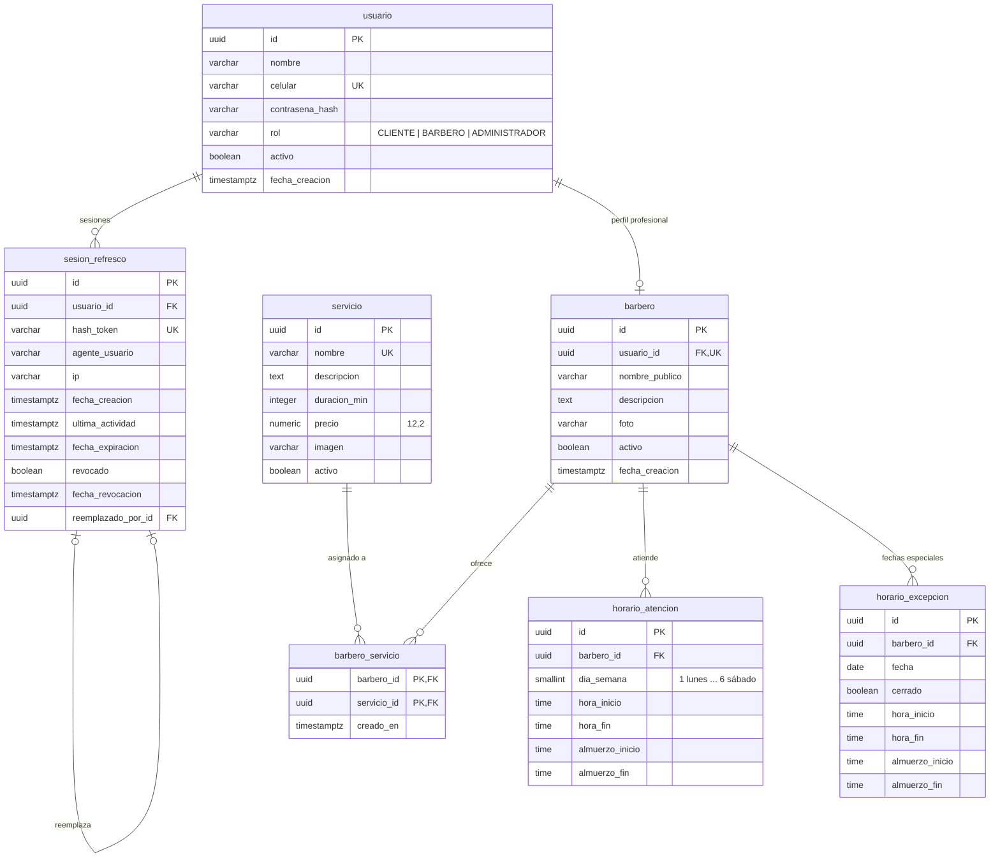
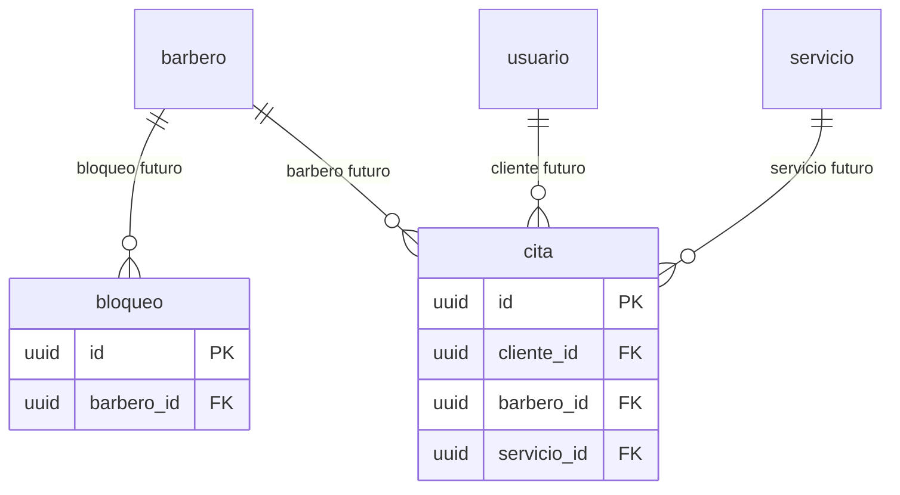

# Modelo de datos OalBarber

**Estado:** modelo de cuentas, catálogo, perfiles, asignaciones y horarios implementado en V1–V8;
bloqueos y citas siguen pendientes. **Última revisión:** 2026-11-24. El SRS se conserva sin cambios.

## Tablas implementadas

Las migraciones crean `usuario` (V1), `sesion_refresco` (V2), `servicio` (V3), `barbero` (V4),
`barbero_servicio` (V5), `horario_atencion` (V7) y `horario_excepcion` (V8). V6 añade
`barbero.fecha_creacion`. Los identificadores de estas tablas son UUID. V4 crea únicamente
`barbero`, con `usuario_id` único, FK a `usuario(id)` y `ON DELETE RESTRICT`. V5 enlaza barbero y
servicio con una clave primaria compuesta, dos FKs con `ON DELETE RESTRICT`, `creado_en` y un
índice para `servicio_id`. V7 guarda una jornada continua por día y barbero, con almuerzo opcional;
V8 añade fechas especiales que abren, cierran o cambian el horario de una fecha concreta.

`barbero` es un perfil separado de la identidad. El nombre, celular y credenciales permanecen en
`usuario`; el perfil guarda presentación pública, estado profesional y fecha de creación. El
inicializador no crea perfil para el administrador: este se agrega explícitamente mediante
`POST /api/barberos/admin`, que solo inserta en `barbero`. Cambiar `barbero.activo` no cambia
`usuario.activo` ni revoca sus sesiones.

`barbero_servicio` representa las asignaciones y pertenece al módulo `barbero`. El módulo consulta
el catálogo a través de `ServicioService`, valida que los servicios estén activos y permite una
lista vacía. Un perfil nuevo comienza sin servicios asignados; el administrador los configura en
`/panel/barberos`.

## Entidades pendientes

El siguiente diagrama muestra entidades del SRS que aún no tienen migración ni implementación.
No representa capacidades disponibles.

La integración de las asignaciones con disponibilidad y la consulta de citas futuras está
pendiente del módulo `cita`. El diseño propuesto usa un puerto propiedad de `barbero` e
implementado por `cita`, para evitar dependencia circular. Detalle y estado de los criterios en la
[matriz H-13](../seguimiento/trazabilidad-H-13.md) y en el
[ADR-0002](../decisiones/ADR-0002-asignacion-barbero-servicio-y-consulta-citas.md).

## Reglas confirmadas

- `usuario.celular` es único y `usuario.contrasena_hash` almacena el hash, no la contraseña.
- `usuario.rol` admite `CLIENTE`, `BARBERO` y `ADMINISTRADOR`.
- `barbero.usuario_id` es único y su FK usa `ON DELETE RESTRICT`.
- Las cuentas y perfiles de barberos se crean desde el flujo administrativo. El administrador ya
  existente puede agregarse explícitamente como perfil sin cambiar su cuenta. Ningún perfil se
  inserta mediante una migración ni por el inicializador.
- `barbero_servicio` evita pares duplicados y restringe el borrado de los registros referenciados.
- `horario_atencion` guarda una jornada continua por día y barbero y evita pares duplicados con una
  clave única de barbero y día; los días sin fila están cerrados. `dia_semana` usa ISO 1–7 y el
  domingo no se configura en la semana (RN-01).
- `horario_excepcion` sobrescribe una fecha concreta y evita duplicados con una clave única de
  barbero y fecha: puede abrir un domingo, cerrar un festivo o cambiar el horario de ese día. Una
  fecha cerrada no lleva horas; una abierta respeta la jornada de 10:00 a 19:00 y el almuerzo
  dentro (RN-01 y RN-02).
- El DTO público de barbero solo lista perfiles activos y no incluye nombre ni celular de la
  cuenta. El DTO administrativo incluye esos campos y `servicioIds`, y está restringido a
  administradores.

## Conteo y SRS

El esquema actualmente implementado corresponde a V1–V8; las tablas restantes descritas por el SRS
se mantienen como trabajo pendiente hasta que existan los módulos respectivos. El detalle de
RF-10 en el SRS aclara que el perfil del administrador es explícito y opcional.
