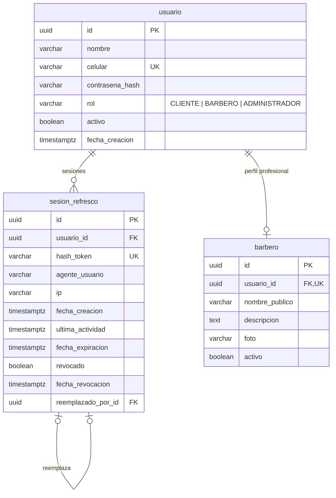
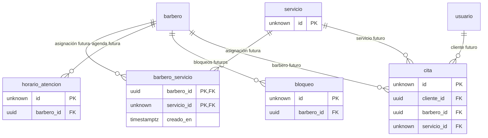

# Modelo de datos OalBarber

**Estado:** esquema implementado para cuentas, catálogo y perfiles; la relación barbero-servicio,
agenda y citas aún no están implementadas. El SRS vigente se conserva sin cambios.

## Estado implementado

Las migraciones actuales crean `usuario` (V1), `sesion_refresco` (V2), `servicio` (V3) y
`barbero` (V4). Las tablas `usuario`, `sesion_refresco` y `barbero` usan UUID. V4 crea únicamente
`barbero`, con `usuario_id` único, FK a `usuario(id)` y `ON DELETE RESTRICT`; no contiene
referencias a servicios ni citas. V4 sigue la migración V3 ya asignada al catálogo.

`barbero` es un perfil separado de la identidad. El nombre, celular y credenciales permanecen en
`usuario`; el perfil guarda presentación pública y estado profesional. El inicializador asegura
un perfil para el administrador inicial. Cambiar `barbero.activo` no cambia `usuario.activo` ni
revoca sus sesiones.

## Entidades conceptuales no implementadas

El siguiente modelo conceptual resume entidades descritas por el SRS; no implica que existan sus
migraciones, entidades o endpoints. El tipo y nombre de tabla de `servicio` deben verificarse en su
implementación antes de integrar la relación.

La relación barbero-servicio se prevé muchos a muchos mediante clave compuesta, pero su
implementación y el tipo de `servicio_id` dependen del esquema real del catálogo. La consulta de
citas futuras se propone a través de `ConsultaCitasFuturas`; su integración y firma concreta
requieren acordarse con el módulo de citas. No se deben presentar estas capacidades como
funcionalidad disponible.

## Reglas confirmadas para las tablas implementadas

- `usuario.celular` es único y `usuario.contrasena_hash` almacena el hash, no la contraseña.
- `usuario.rol` admite `CLIENTE`, `BARBERO` y `ADMINISTRADOR`.
- `barbero.usuario_id` es único y su FK usa `ON DELETE RESTRICT`.
- Las cuentas de barbero y perfil se crean desde el flujo administrativo; los perfiles no se
  insertan mediante una migración.
- El DTO público de barbero solo lista perfiles activos y no incluye nombre ni celular de la
  cuenta. El DTO administrativo sí incluye esos campos y está restringido a administradores.

## Conteo y SRS

El SRS adjunto mantiene su conteo de ocho tablas. El modelo conceptual de nueve tablas incluye
`barbero` y `barbero_servicio`; cualquier ajuste al SRS requiere aprobación. El SRS se deja intacto.
